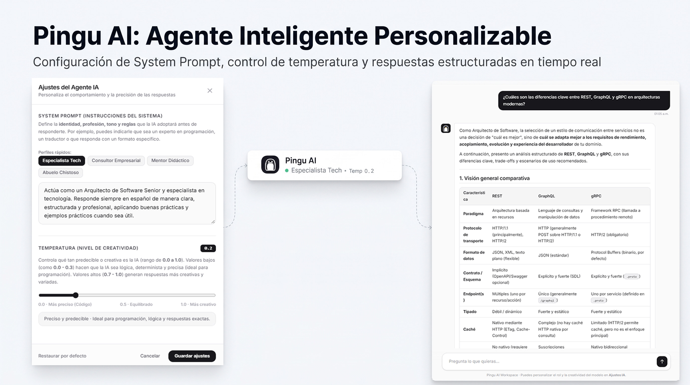

<p align="center">
  
</p>

<h1 align="center">Pingu AI</h1>

<p align="center">
  Interfaz web minimalista de chat asistido por inteligencia artificial con streaming en tiempo real, formateo Markdown y configuración dinámica de parámetros del modelo.
</p>

<p align="center">
  <a href="https://youtu.be/RYuiaMsoVFo" target="_blank" rel="noopener noreferrer">
    
  </a>
  <br />
  <em>Haz clic en la imagen o <a href="https://youtu.be/RYuiaMsoVFo" target="_blank" rel="noopener noreferrer"><strong>aquí para ver el video demostrativo en YouTube (0:34)</strong></a>.</em>
</p>

---

## Descripción

**Pingu AI** es una aplicación web desarrollada con JavaScript moderno, Vite y Tailwind CSS v4 que se integra con OpenRouter mediante el Vercel AI SDK. Permite interactuar con modelos de lenguaje de gran escala (LLMs) en tiempo real, ofreciendo al usuario control directo sobre el comportamiento del sistema (*System Prompt*) y el nivel de determinismo o creatividad (*Temperatura*).

## Características

- **Streaming en tiempo real**: Visualización progresiva de respuestas token por token mediante `streamText`.
- **Renderizado Markdown nativo**: Formateo automático y seguro de encabezados, listas, citas, tablas y bloques de código con opción de copiado individual.
- **Configuración del modelo en caliente**: Panel de ajustes para definir el *System Prompt* personalizado, seleccionar perfiles predefinidos y ajustar la temperatura (`0.0` a `1.0`).
- **Temas claro y oscuro**: Interfaz adaptable con soporte para preferencias del sistema operativo y persistencia en `localStorage`.
- **Arquitectura modular**: Separación clara de responsabilidades entre configuración, renderizado de interfaz, utilidades de formateo y lógica principal.



## Tecnologías

- **Entorno de desarrollo**: Vite
- **Estilos**: Tailwind CSS v4 (`@tailwindcss/vite`)
- **Integración IA**: Vercel AI SDK (`ai`) + OpenRouter Provider (`@openrouter/ai-sdk-provider`)
- **Lenguaje**: JavaScript (ES Modules)

## Requisitos previos

- **Node.js**: Versión 20.19+ o 22+ LTS recomendada.
- **API Key de OpenRouter**: Clave activa obtenida en [openrouter.ai](https://openrouter.ai).

## Instalación y configuración

1. **Clonar el repositorio:**
   ```bash
   git clone https://github.com/Carlos-MKR/pingu-ai
   cd pingu-ai
   ```

2. **Instalar dependencias:**
   ```bash
   npm install
   ```

3. **Configurar variables de entorno:**
   Crea un archivo `.env` en la raíz del proyecto (puedes duplicar o renombrar `.env.template`):
   ```env
   VITE_OPENROUTER_API_KEY=tu_api_key_de_openrouter
   # Opcional (por defecto usa nvidia/nemotron-3.5-super-vl:free). Explora más en https://openrouter.ai/models
   VITE_OPENROUTER_MODEL=nvidia/nemotron-3.5-super-vl:free
   ```

4. **Iniciar el servidor de desarrollo:**
   ```bash
   npm run dev
   ```

5. **Compilar para producción:**
   ```bash
   npm run build
   ```

## Estructura del proyecto

```text
├── public/
│   └── favicon.svg          # Logotipo vectorial de Pingu AI
├── src/
│   ├── config/
│   │   └── settings.js      # Estado, perfiles predefinidos y persistencia
│   ├── ui/
│   │   ├── chatUI.js        # Renderizado de mensajes y control de tema
│   │   └── settingsModal.js # Controlador del modal de ajustes de IA
│   ├── utils/
│   │   └── markdown.js      # Motor de conversión Markdown a HTML seguro
│   ├── main.js              # Punto de entrada e integración con OpenRouter
│   └── style.css            # Estilos globales y tipografía Markdown
├── index.html               # Estructura principal de la aplicación
└── vite.config.ts           # Configuración de Vite y Tailwind CSS
```

